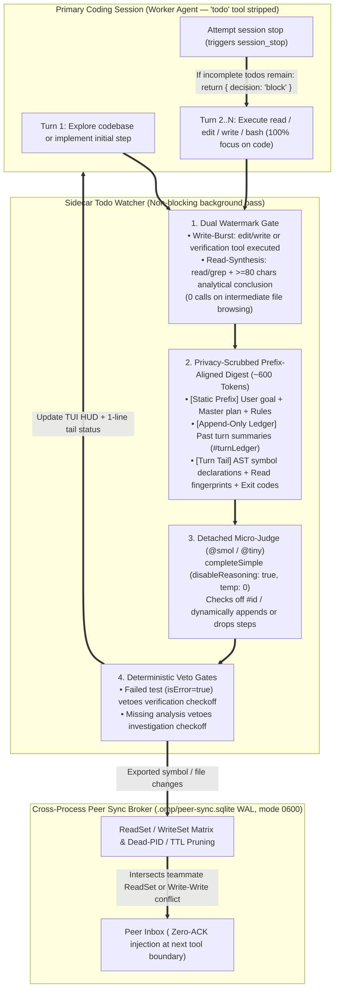

# omp-sidecar-todo-watcher

**[English](./README.md) | [简体中文](./README.zh-CN.md)**

**Zero-Friction Sidecar Todo Watcher & Cross-Session Peer Sync Broker for [Oh My Pi (`omp`)](https://omp.sh).**

---

## 1. Problem Statement

In multi-step software engineering and parallel multi-agent workflows, relying on the primary coding LLM to manually manage its own `todo` list exhibits three empirical failure modes:

1. **End-of-Run Batching & Omission**:
   - In `omp`'s built-in `TodoTracker`, mid-run reminders only fire after 12 consecutive mutating tool calls (`v = 12`) and at most twice per session (`x = 2`). Under default settings (`todo.eager: "default"`, `tools.xdev: true`), the primary model frequently completes entire multi-file tasks with **0 `todo` calls**, or batches a single untargeted `todo({ op: "done" })` call at the very end of the run.
2. **Verbatim String-Matching Friction & Cross-Task Leakage ([`opencode#41359`](https://github.com/anomalyco/opencode/issues/41359))**:
   - Calling `todo({ op: "done", task: "..." })` requires exact string equality against the initial task text, which often sits 20,000+ tokens earlier in the transcript.
   - Completed todo lists remain stuck on screen when a new task is prompted in the same session.
3. **Cross-Session Mutual Blindness**:
   - Multiple `omp` sessions working concurrently on the same repository have no visibility into each other's file reads (`ReadSet`), code modifications (`WriteSet`), or exported interface changes until merge conflicts occur.

---

## 2. Architecture & How It Works

`omp-sidecar-todo-watcher` decouples administrative bookkeeping from coding by **removing `todo` from the main model's active tools** and delegating progress tracking and peer synchronization to a non-blocking **Detached Micro-Judge (`@smol` / `@tiny`)** and a **SQLite WAL Peer Sync Broker**:



### Key Mechanisms

1. **Zero Administrative Tax on the Main Model**:
   Strips `"todo"` from the primary model's active tool list at `session_start`, automatically silencing built-in mid-run nudges and saving ~800 tokens of tool schema per turn.
2. **Non-Blocking Background Execution**:
   Dispatches sidecar evaluation off the critical path at `turn_end` via `ctx.setTimeout(..., 0)` so the primary model starts its next turn with **0 ms added latency**. Counters are snapshotted and cleared atomically before network I/O with a coalesced `rerunRequested` queue to prevent Lost Update anomalies.
3. **Full-File Symbol Declaration Pre-Extraction & Read-Evidence Fingerprints**:
   - Scans `write`/`edit` payloads for all top-level `export function/class/interface/type`, `def`, `fn`, and `test()` declarations (`summarizeCodeChange`), solving the untracked-file empty `git diff` problem and large-file tail truncation.
   - Extracts compact (~120-char) symbol fingerprints from `read`/`grep`/`lsp` results (`summarizeReadEvidence`) paired with a **Read-Synthesis Watermark** (a read plus >= 80 chars of analysis, see `Burst.hasPendingActivity` in `src/watcher/burst.ts`) to accurately evaluate pure investigation/audit tasks.
4. **Prefix-Aligned Append-Only Micro-Ledger (`#turnLedger`)**:
   Structures prompts strictly as `[Static Goal & Master Plan] -> [Static Rules] -> [Append-Only Turn Ledger] -> [Current Burst Delta]` with a pinned `sessionId` and `promptCacheKey` to prevent cross-turn amnesia and maximize prefix cache hits.
5. **Privacy & Secret Protection by Default (`redactSecrets` & `isSensitiveFilePath`)**:
   - Automatically blocks content and diff extraction for sensitive files (`.env*`, `*.pem`, `*.key`, `id_rsa*`, `id_ed25519*`, `.npmrc`, `.netrc`, `*secret*`, `*credential*`, `~/.ssh/*`, `~/.aws/*`).
   - Scrubs API keys (`sk-...`, `ghp_...`, `github_pat_...`, `AKIA...`, `AIza...`, `xoxb-...`), Bearer tokens, JWTs, PEM private keys, and `PASSWORD`/`SECRET`/`TOKEN` assignments before any text is sent to the Sidecar model or written to disk.
   - Enforces `0700` directory and `0600` file permissions on `.omp/peer-sync.sqlite` (and its `-wal`/`-shm` files).

---

## 3. Empirical Benchmarks (`Detached-Smol` vs. `Ephemeral`)

Measured on `omp v18.16.0` across a multi-step TypeScript implementation and test verification workflow (`src/calc.ts` $\rightarrow$ `src/formatter.ts` $\rightarrow$ `calc.test.ts` + `bun test`):

### 3.1 Aggregate Token Consumption, Cache Hit Rate & Cost

| Mode & Watcher Model | Calls | Uncached Input (`input`) | Cached Read (`cacheRead`) | Output (`output`) | **Total Watcher Tokens** | **Cache Hit Rate** | **Watcher Cost (`USD`)** | **Avg Call Latency** | **End-to-End Wall Time** |
| :--- | ---: | ---: | ---: | ---: | ---: | ---: | ---: | ---: | ---: |
| `ephemeral` + `claude-opus-5-5` | 4 | 3,847 | 51,807 | 721 | 56,375 | `93.1%` | `$0.04017` | `3,612 ms` | `21.47 s` |
| `ephemeral` + `gemini-3.8-flash` (`@smol`) | 4 | 37,457 | 0 | 253 | 37,710 | `0.0%` | `$0.02904` | `2,365 ms` | `19.74 s` |
| `ephemeral` + `deepseek-v4.1-flash` (`@tiny`) | 5 | 40,706 | 17,024 | 315 | 58,045 | `29.5%` | `$0.01269` | `5,250 ms` | `37.58 s` |
| **`detached-smol` + `gemini-3.8-flash` (`@smol`)** | **4** | **2,201** | **0** | **286** | **`2,487` (-95.6%)** | `0.0%` | **`$0.00272` (-93.2%)** | **`1,964 ms`** | **`16.60 s`** |
| **`detached-smol` + `deepseek-v4.1-flash` (`@tiny`)** | **4** | **6,848** | **4,608** | **373** | **`11,829` (-79.6%)** | **`40.2%` (peak `89.2%`)** | **`$0.00253` (-93.7%)** | `3,839 ms` | `20.84 s` |

### 3.2 Visual Comparison Charts

```text
Total Sidecar Tokens Consumed (Lower is better)
──────────────────────────────────────────────────────────────────────────────
ephemeral + deepseek-v4.1-flash │ ████████████████████████████████████  58,045
ephemeral + claude-opus-5-5     │ ███████████████████████████████████   56,375
ephemeral + gemini-3.8-flash    │ ███████████████████████               37,710
detached  + deepseek-v4.1-flash │ ███████                               11,829
detached  + gemini-3.8-flash    │ █▌                                     2,487 (-95.6%)

Uncached Billable Input Tokens (Lower is better)
──────────────────────────────────────────────────────────────────────────────
ephemeral + deepseek-v4.1-flash │ ████████████████████████████████████  40,706
ephemeral + gemini-3.8-flash    │ █████████████████████████████████     37,457
detached  + deepseek-v4.1-flash │ ██████                                 6,848
ephemeral + claude-opus-5-5     │ ███▍                                   3,847
detached  + gemini-3.8-flash    │ █▉                                     2,201 (-94.1%)

Total Watcher Cost per Multi-Step Task in USD (Lower is better)
──────────────────────────────────────────────────────────────────────────────
ephemeral + claude-opus-5-5     │ ████████████████████████████████████  $0.04017 (15.9x)
ephemeral + gemini-3.8-flash    │ ██████████████████████████            $0.02904 (11.5x)
ephemeral + deepseek-v4.1-flash │ ███████████▍                          $0.01269 ( 5.0x)
detached  + gemini-3.8-flash    │ ██▍                                   $0.00272 ( 1.1x)
detached  + deepseek-v4.1-flash │ ██▏                                   $0.00253 ( 1.0x)
```



```mermaid
xychart-beta
    title "Detached-Smol vs. Ephemeral: Uncached Input vs. Cached Read Tokens"
    x-axis ["Opus (Ephemeral)", "Gemini-Flash (Ephemeral)", "DeepSeek-Flash (Ephemeral)", "Gemini-Flash (Detached)", "DeepSeek-Flash (Detached)"]
    y-axis "Tokens" 0 --> 60000
    bar [3847, 37457, 40706, 2201, 6848]
    bar [51807, 0, 17024, 0, 4608]
```

### 3.3 Per-Call Breakdown

#### (A) `gemini-3.8-flash` (`@smol`): `ephemeral` vs. `detached-smol`

| Call | `ephemeral` (`input` / `cache`) | `ephemeral` Output | `ephemeral` Cost | **`detached` (`input` / `cache`)** | **`detached` Output** | **`detached` Cost** | **Token Reduction** |
| :--- | ---: | ---: | ---: | ---: | ---: | ---: | ---: |
| **Call 1 (`init`)** | `8,775` / `0` | 108 | `$0.00699` | **`450` / `0`** | **101** | **`$0.00072`** | **-93.8%** |
| **Call 2 (`delta`)** | `9,248` / `0` | 54 | `$0.00714` | **`714` / `0`** | **52** | **`$0.00073`** | **-91.8%** |
| **Call 3 (`delta`)** | `9,789` / `0` | 40 | `$0.00749` | **`837` / `0`** | **29** | **`$0.00074`** | **-91.2%** |
| **Call 4 (`delta`)** | `9,645` / `0` | 51 | `$0.00743` | **`649` / `0`** | **41** | **`$0.00064`** | **-92.9%** |
| **Total (4 calls)** | **`37,457` / `0`** | **253** | **`$0.02904`** | **`2,650` / `0`** | **223** | **`$0.00282`** | **-92.4% (-90.3% cost)** |

#### (B) `deepseek-v4.1-flash` (`@tiny`): `ephemeral` vs. `detached-smol`

| Call | `ephemeral` (`input` / `cacheRead`) | `ephemeral` Hit Rate | `ephemeral` Cost | **`detached` (`input` / `cacheRead`)** | **`detached` Hit Rate** | **`detached` Cost** |
| :--- | ---: | ---: | ---: | ---: | ---: | ---: |
| **Call 1 (`init`)** | `8,795` / `2,048` | `18.9%` | `$0.00276` | **`2,614` / `0`** | `0.0%` | **`$0.00106`** |
| **Call 2 (`delta`)** | `9,408` / `1,792` | `16.0%` | `$0.00290` | **`884` / `2,048`** | **`69.8%`** | **`$0.00035`** |
| **Call 3 (`delta`)** | `9,762` / `1,792` | `15.5%` | `$0.00301` | **`3,041` / `0`** | `0.0%` | **`$0.00096`** |
| **Call 4 (`delta`)** | `12,109` / `0` | `0.0%` | `$0.00367` | **`309` / `2,560`** | **`89.2%`** | **`$0.00017`** |
| **Call 5 (`delta`)** | `632` / `11,392` | `94.7%` | `$0.00034` | — (settled in 4 calls) | — | — |
| **Total** | **`40,706` / `17,024`** | **`29.5%`** | **`$0.01269`** | **`6,848` / `4,608`** | **`40.2%`** | **`$0.00253` (-80.1% cost)** |

---

## 4. Installation

Requires `omp` 18.13 or newer, whose runtime meets the `engines.bun` range in `package.json`.

### Option 1: Install via `omp` Marketplace (Recommended)

```bash
# Add from GitHub (or a local clone path)
omp plugin marketplace add lbyxiaolizi/omp-sidecar-todo-watcher

# Install globally for all projects
omp plugin install sidecar-todo-watcher@omp-sidecar-todo-watcher

# Or install for the current project only
omp plugin install --scope project sidecar-todo-watcher@omp-sidecar-todo-watcher
```

### Option 2: Persistent Configuration in `~/.omp/agent/config.yml`

```bash
git clone https://github.com/lbyxiaolizi/omp-sidecar-todo-watcher.git ~/.omp/plugins/omp-sidecar-todo-watcher
```

```yaml
extensions:
  - ~/.omp/plugins/omp-sidecar-todo-watcher
```

### Option 3: One-Off CLI Flag

```bash
omp -e ~/.omp/plugins/omp-sidecar-todo-watcher
```

---

## 5. Commands & Configuration

### Slash Commands (`/peer-todos`)

| Command | Description |
| :--- | :--- |
| `/peer-todos` or `/peer-todos status` | Show managed todos, active peers, and Sidecar token/cache/cost telemetry |
| `/peer-todos model [spec]` | View or set the Sidecar Watcher model (e.g., `/peer-todos model @smol` or `@tiny`) |
| `/peer-todos mode <auto\|detached\|ephemeral>` | Switch between `detached` (micro-judge), `ephemeral` (shared-cache), or `auto` |
| `/peer-todos add <task>` | Manually append a todo item |
| `/peer-todos done <#id\|keyword>` | Manually mark a todo item completed and advance the active cursor |
| `/peer-todos reset` | Archive and clear the current todo list |
| `/peer-todos pause` / `resume` | Pause or resume automatic Sidecar Watcher checks |
| `/peer-todos broadcast <msg>` | Broadcast a technical `<peer-sync>` notice to all active peers in the repository |

### Environment Variables

| Variable | Default | Description |
| :--- | :--- | :--- |
| `OMP_PEER_ID` | Session UUID prefix | Human-readable peer identifier (e.g., `peer-backend`, `peer-frontend`) |
| `OMP_WATCHER_MODEL` | `@smol` $\rightarrow$ `@tiny` $\rightarrow$ `@commit` | Preferred model selector for the Detached Micro-Judge |
| `OMP_WATCHER_MODE` | `auto` | Execution mode: `auto` \| `detached` \| `ephemeral` |
| `OMP_PEER_BROKER_DB` | `<cwd>/.omp/peer-sync.sqlite` | Path to the SQLite WAL cross-session coordination database |

---

## 6. Privacy & Security Guarantees

- **Sensitive File Exclusion**: `.env*`, `*.pem`, `*.key`, `id_rsa*`, `id_ed25519*`, `.npmrc`, `.netrc`, `*secret*`, `*credential*`, `~/.ssh/*`, and `~/.aws/*` are automatically excluded from snippet extraction and `git diff` collection.
- **In-Memory Credential Redaction**: All text fragments passed to the Sidecar model or written to SQLite are scrubbed for OpenAI/Anthropic/GitHub/AWS/Slack/Google tokens, JWTs, Bearer headers, PEM blocks, and `KEY`/`SECRET`/`PASSWORD` assignments.
- **Owner-Only Local Storage**: `.omp/peer-sync.sqlite` and its directory are created with `0600` / `0700` permissions on POSIX systems, and stale/crashed peer entries are pruned automatically via `process.kill(pid, 0)` and a 15-minute TTL.

## Development & Testing

```bash
bun install
bun run test
bun run build
```

`omp` installs plugins by copying the repository, so the built `dist/` is committed. The devenv pre-commit hook rebuilds it when source files are committed.

## License

[MIT](./LICENSE)
