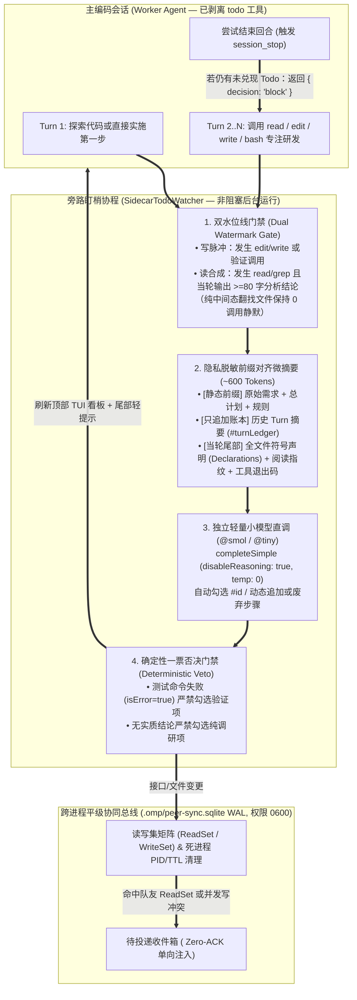

# omp-sidecar-todo-watcher

**[English](./README.md) | [简体中文](./README.zh-CN.md)**

面向 [Oh My Pi (`omp`)](https://omp.sh) 的**零摩擦旁路 Todo 全托管状态机（Sidecar Todo Watcher）**与**跨进程平级 Agent 实时同步总线（Peer Sync Broker）**扩展插件。

---

## 1. 解决的核心工程痛点

在多步复杂工程与多智能体并行开发场景下，原生 Coding Agent 的 `todo` 工具与多会话协作存在三个经实证确认的机制缺陷：

1. **主模型“拖延勾 Todo”或彻底不建档**：
   - 在 `omp` 原生实现（`todo-tracker.ts`）中，中途提醒阈值硬编码为连续 12 次重型写操作（`v = 12`）且最多提醒 2 次（`x = 2`）；同时在默认配置（`todo.eager: "default"`、`tools.xdev: true`）下，主模型在自然多文件任务中经常全程 **0 次调用 `todo`**，或把所有活干完后才在最后一轮用无参 `todo({ op: "done" })` 一次性清场。
2. **原文字面量精确匹配摩擦与串任务残留（[`opencode#41359`](https://github.com/anomalyco/opencode/issues/41359)）**：
   - 原生 `todo` 要求传入与 `init` 时一字不差的任务长字符串（`findTaskByContent`），跑满 20 轮工具后极易因字符偏差报 `isError: true`；
   - 当同一会话内完成旧任务并输入新任务 Prompt 时，已完成的旧 Todo 列表不会自动归档重置。
3. **多终端平级会话之间的“视野全盲（Mutual Blindness）”**：
   - 多个平级 `omp` 会话在同一仓库并发修改代码时，彼此不知道对方读过哪些文件、改了哪些导出接口，直到合并时才爆发语义冲突（Stale Read / Write Skew）。

---

## 2. 架构设计与工作原理

本插件通过**“彻底剥离主模型记账职责 + 独立轻量小模型旁路审阅 + SQLite WAL 读写集交集路由”**实现零心智负担的自动化管理：



### 六大核心机制

1. **主模型 `todo` 物理剥离**：
   在 `session_start` 时从主模型激活工具集中移除 `"todo"`，自动静默原生 `omp` 滞后的内置催促器，主模型 100% 算力用于写代码。
2. **非阻塞异步审阅（Zero Critical-Path Latency）**：
   在 `turn_end` 中通过受管定时器 `ctx.setTimeout(..., 0)` 脱离主事件循环关键路径，让旁路小模型与主模型的下一轮推理 **100% 并发执行**；并在发起网络请求前执行**原子快照清零**与 `rerunRequested` 合并队列，杜绝异步窗口期的丢失更新（Lost Update）。
3. **全文件符号声明预提取（`summarizeCodeChange`）与阅读微指纹（`summarizeReadEvidence`）**：
   - 直接从 `write`/`edit` 工具载荷中扫描全文件 `export function/class/interface/type`、`def`、`fn`、`test()` 声明行，解决新建未 `git add` 文件 `git diff` 为空及长文件尾部截断盲区；
   - 从 `read`/`grep`/`lsp` 输出中提取 ~120 字符符号指纹，配合“读脉冲 + 结论合成（$\ge 80$ 字）”水位线，精准支持纯阅读/调查分析类 Todo。
4. **前缀对齐的只追加微型账本（Prefix-Aligned `#turnLedger`）**：
   严格按照 `[静态目标与总计划] -> [静态规则] -> [只追加历史轮次账本] -> [当轮增量]` 构造 Prompt，并绑定固定 `sessionId` 与 `promptCacheKey`，消除跨轮次失忆并最大化前缀缓存复用。
5. **默认隐私与凭据安全保护（`redactSecrets` & `isSensitiveFilePath`）**：
   - 自动阻断对敏感路径（`.env*`、`*.pem`、`*.key`、`id_rsa*`、`id_ed25519*`、`.npmrc`、`.netrc`、`*secret*`、`*credential*`、`~/.ssh/*`、`~/.aws/*`）的文件内容提取与 `git diff` 采集；
   - 在向旁路模型发送任何文本或写入 SQLite 前，自动对 API Key（`sk-...`、`ghp_...`、`github_pat_...`、`AKIA...`、`AIza...`、`xoxb-...`）、Bearer Token、JWT、PEM 私钥块及密码赋值语句执行正则脱敏；
   - 数据库目录与文件强制启用 `0700` / `0600` 仅属主可读写权限。
6. **跨进程平级协同总线（`PeerSyncBroker`）**：
   - 基于 `node:sqlite` WAL 模式，自动追踪同一仓库下所有活跃 `omp` 进程的 `PID`、`ReadSet` 与 `WriteSet`（自动通过 `process.kill(pid, 0)` + 15 分钟 TTL 清理崩溃僵尸节点）；
   - 当节点 A 修改了节点 B 曾读取过的文件或更新了导出符号时，在节点 B 的下一个 `tool_result` 边界自动注入零寒暄（Zero-ACK）的 `<peer-sync>` 卡片；当两个平级节点同时修改同一文件时，立即向双方注入 `kind="write_conflict"` 告警。

---

## 3. 实机基准测试数据（Empirical Benchmarks）

在 `omp v18.16.0` 上针对同一多步 TypeScript 编码与测试任务（`src/calc.ts` $\rightarrow$ `src/formatter.ts` $\rightarrow$ `calc.test.ts` + `bun test`）采集的底层 `usage` 账单对比：

### 3.1 总体 Token 消耗、缓存命中率与成本对比表

| 模式与模型配置 | 调用次数 | 未缓存输入 (`input`) | 命中缓存 (`cacheRead`) | 输出 (`output`) | **旁路总 Token** | **Cache Hit 率** | **旁路总费用 (`USD`)** | **单次平均耗时** | **端到端总耗时** |
| :--- | ---: | ---: | ---: | ---: | ---: | ---: | ---: | ---: | ---: |
| `ephemeral` + `claude-opus-5-5` | 4 | 3,847 | 51,807 | 721 | 56,375 | `93.1%` | `$0.04017` | `3,612 ms` | `21.47 s` |
| `ephemeral` + `gemini-3.8-flash` (`@smol`) | 4 | 37,457 | 0 | 253 | 37,710 | `0.0%` | `$0.02904` | `2,365 ms` | `19.74 s` |
| `ephemeral` + `deepseek-v4.1-flash` (`@tiny`) | 5 | 40,706 | 17,024 | 315 | 58,045 | `29.5%` | `$0.01269` | `5,250 ms` | `37.58 s` |
| **`detached-smol` + `gemini-3.8-flash` (`@smol`)** | **4** | **2,201** | **0** | **286** | **`2,487` (-95.6%)** | `0.0%` | **`$0.00272` (-93.2%)** | **`1,964 ms`** | **`16.60 s`** |
| **`detached-smol` + `deepseek-v4.1-flash` (`@tiny`)** | **4** | **6,848** | **4,608** | **373** | **`11,829` (-79.6%)** | **`40.2%` (峰值 `89.2%`)** | **`$0.00253` (-93.7%)** | `3,839 ms` | `20.84 s` |

### 3.2 可视化消耗对比图（Total Tokens & Cost USD）

```text
旁路总 Token 消耗对比 (越短越优)
──────────────────────────────────────────────────────────────────────────────
ephemeral + deepseek-v4.1-flash │ ████████████████████████████████████  58,045
ephemeral + claude-opus-5-5     │ ███████████████████████████████████   56,375
ephemeral + gemini-3.8-flash    │ ███████████████████████               37,710
detached  + deepseek-v4.1-flash │ ███████                               11,829
detached  + gemini-3.8-flash    │ █▌                                     2,487 (-95.6%)

未缓存计费 Input Token 对比 (决定真实账单的核心指标，越短越优)
──────────────────────────────────────────────────────────────────────────────
ephemeral + deepseek-v4.1-flash │ ████████████████████████████████████  40,706
ephemeral + gemini-3.8-flash    │ █████████████████████████████████     37,457
detached  + deepseek-v4.1-flash │ ██████                                 6,848
ephemeral + claude-opus-5-5     │ ███▍                                   3,847
detached  + gemini-3.8-flash    │ █▉                                     2,201 (-94.1%)

整场任务 Watcher 总费用对比 (USD，越短越优)
──────────────────────────────────────────────────────────────────────────────
ephemeral + claude-opus-5-5     │ ████████████████████████████████████  $0.04017 (15.9x)
ephemeral + gemini-3.8-flash    │ ██████████████████████████            $0.02904 (11.5x)
ephemeral + deepseek-v4.1-flash │ ███████████▍                          $0.01269 ( 5.0x)
detached  + gemini-3.8-flash    │ ██▍                                   $0.00272 ( 1.1x)
detached  + deepseek-v4.1-flash │ ██▏                                   $0.00253 ( 1.0x)
```



```mermaid
xychart-beta
    title "Detached-Smol vs. Ephemeral: Uncached Input vs. Cached Read Tokens"
    x-axis ["Opus (Ephemeral)", "Gemini-Flash (Ephemeral)", "DeepSeek-Flash (Ephemeral)", "Gemini-Flash (Detached)", "DeepSeek-Flash (Detached)"]
    y-axis "Tokens" 0 --> 60000
    bar [3847, 37457, 40706, 2201, 6848]
    bar [51807, 0, 17024, 0, 4608]
```

### 3.3 逐轮调用（Per-Call）明细对比

#### (A) `gemini-3.8-flash` (`@smol`)：`ephemeral` vs. `detached-smol` 逐轮账单

| 调用轮次 | `ephemeral` 输入 (`input`/`cache`) | `ephemeral` 输出 | `ephemeral` 单次费用 | **`detached` 输入 (`input`/`cache`)** | **`detached` 输出** | **`detached` 单次费用** | **单次 Token 降幅** |
| :--- | ---: | ---: | ---: | ---: | ---: | ---: | ---: |
| **Call 1 (`init`)** | `8,775` / `0` | 108 | `$0.00699` | **`450` / `0`** | **101** | **`$0.00072`** | **-93.8%** |
| **Call 2 (`delta`)** | `9,248` / `0` | 54 | `$0.00714` | **`714` / `0`** | **52** | **`$0.00073`** | **-91.8%** |
| **Call 3 (`delta`)** | `9,789` / `0` | 40 | `$0.00749` | **`837` / `0`** | **29** | **`$0.00074`** | **-91.2%** |
| **Call 4 (`delta`)** | `9,645` / `0` | 51 | `$0.00743` | **`649` / `0`** | **41** | **`$0.00064`** | **-92.9%** |
| **合计（4 次）** | **`37,457` / `0`** | **253** | **`$0.02904`** | **`2,650` / `0`** | **223** | **`$0.00282`** | **-92.4% (省 90.3% 费用)** |

#### (B) `deepseek-v4.1-flash` (`@tiny`)：`ephemeral` vs. 优化后 `detached-smol` 逐轮账单

| 调用轮次 | `ephemeral` (`input` / `cacheRead`) | `ephemeral` Hit 率 | `ephemeral` 费用 | **`detached` (`input` / `cacheRead`)** | **`detached` Hit 率** | **`detached` 费用** |
| :--- | ---: | ---: | ---: | ---: | ---: | ---: |
| **Call 1 (`init`)** | `8,795` / `2,048` | `18.9%` | `$0.00276` | **`2,614` / `0`** | `0.0%` | **`$0.00106`** |
| **Call 2 (`delta`)** | `9,408` / `1,792` | `16.0%` | `$0.00290` | **`884` / `2,048`** | **`69.8%`** | **`$0.00035`** |
| **Call 3 (`delta`)** | `9,762` / `1,792` | `15.5%` | `$0.00301` | **`3,041` / `0`** | `0.0%` | **`$0.00096`** |
| **Call 4 (`delta`)** | `12,109` / `0` | `0.0%` | `$0.00367` | **`309` / `2,560`** | **`89.2%`** | **`$0.00017`** |
| **Call 5 (`delta`)** | `632` / `11,392` | `94.7%` | `$0.00034` | —（4 次即全部完成） | — | — |
| **合计** | **`40,706` / `17,024`** | **`29.5%`** | **`$0.01269`** | **`6,848` / `4,608`** | **`40.2%`** | **`$0.00253` (省 80.1% 费用)** |

---

## 4. 安装与启用方式

需要 `omp` 18.13 或更新版本，其运行时满足 `package.json` 中 `engines.bun` 的版本范围。

### 方式一：通过 `omp` Marketplace 安装（推荐）

```bash
# 添加 GitHub 仓库（或本地克隆路径）作为 Marketplace 源
omp plugin marketplace add lbyxiaolizi/omp-sidecar-todo-watcher

# 全局安装插件（所有项目自动生效）
omp plugin install sidecar-todo-watcher@omp-sidecar-todo-watcher

# 或仅在当前项目安装
omp plugin install --scope project sidecar-todo-watcher@omp-sidecar-todo-watcher
```

### 方式二：在 `~/.omp/agent/config.yml` 中配置常驻加载

```bash
git clone https://github.com/lbyxiaolizi/omp-sidecar-todo-watcher.git ~/.omp/plugins/omp-sidecar-todo-watcher
```

```yaml
extensions:
  - ~/.omp/plugins/omp-sidecar-todo-watcher
```

### 方式三：单次命令行挂载

```bash
omp -e ~/.omp/plugins/omp-sidecar-todo-watcher
```

---

## 5. 交互式命令与环境变量

### 斜杠命令（`/peer-todos`）

| 命令 | 功能说明 |
| :--- | :--- |
| `/peer-todos` 或 `/peer-todos status` | 查看当前托管 Todo 列表、在线平级队友状态及旁路 Token/费用统计 |
| `/peer-todos model [spec]` | 查看或动态切换旁路小模型（例如 `/peer-todos model @smol` 或 `@tiny`） |
| `/peer-todos mode <auto\|detached\|ephemeral>` | 切换运行模式：`detached`（独立小模型极简直调）、`ephemeral`（主模型共享缓存）、`auto`（默认） |
| `/peer-todos add <任务描述>` | 手动追加一条待办任务 |
| `/peer-todos done <#序号 或 关键词>` | 手动将某条待办任务标记为完成并推进活跃游标 |
| `/peer-todos reset` | 归档并清空当前 Todo 列表 |
| `/peer-todos pause` / `resume` | 暂停或恢复旁路 Watcher 自动审阅 |
| `/peer-todos broadcast <消息内容>` | 向同一仓库下所有在线平级 `omp` 节点广播一条技术同步通知 |

### 环境变量

| 变量名 | 默认值 | 说明 |
| :--- | :--- | :--- |
| `OMP_PEER_ID` | 会话 UUID 前缀 | 当前平级节点的可读标识（如 `peer-backend`、`peer-frontend`） |
| `OMP_WATCHER_MODEL` | `@smol` $\rightarrow$ `@tiny` $\rightarrow$ `@commit` | 指定旁路审阅使用的模型选择器 |
| `OMP_WATCHER_MODE` | `auto` | 可选 `auto` \| `detached` \| `ephemeral` |
| `OMP_PEER_BROKER_DB` | `<cwd>/.omp/peer-sync.sqlite` | 跨进程 SQLite WAL 协同数据库路径 |

---

## 6. 隐私与安全保障

- **敏感文件自动隔离**：自动跳过 `.env*`、`*.pem`、`*.key`、`id_rsa*`、`id_ed25519*`、`.npmrc`、`.netrc`、`*secret*`、`*credential*`、`~/.ssh/*` 及 `~/.aws/*` 的内容快照与 `git diff` 提取。
- **内存态凭据脱敏**：所有发往旁路模型或写入 SQLite 的文本片段均经过 `redactSecrets` 清洗，自动抹除主流云厂商/模型 API Key、GitHub PAT、Bearer Token、JWT、PEM 私钥块及密码赋值字段。
- **最小权限本地存储**：`.omp/peer-sync.sqlite` 及其目录强制采用 `0600` / `0700` POSIX 权限创建，并通过 `process.kill(pid, 0)` 与 15 分钟 TTL 自动清理已退出的会话记录。

## 开发与测试

```bash
bun install
bun run test
bun run build
```

`omp` 通过复制仓库来安装插件，所以构建出的 `dist/` 需要提交进仓库。devenv 的 pre-commit hook 会在提交源码时自动重新构建它。

## License

[MIT](./LICENSE)
